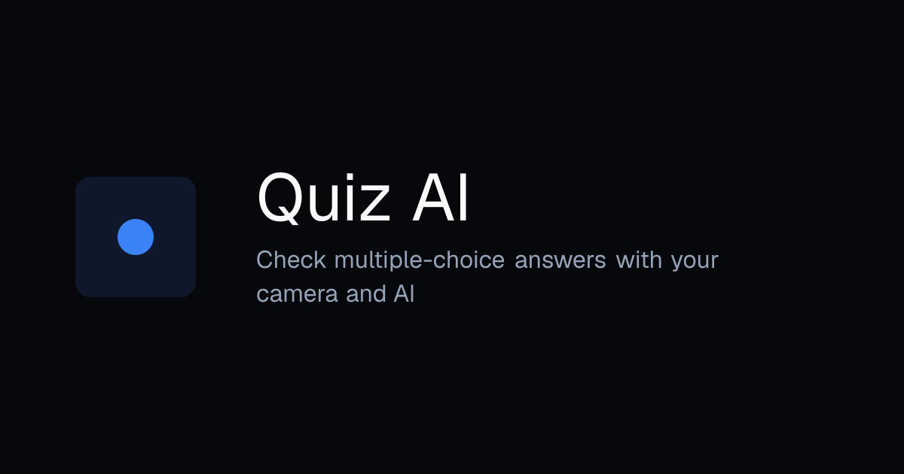
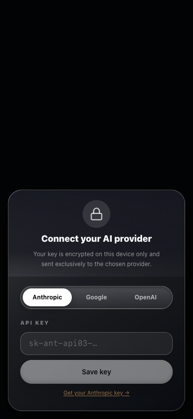

<p align="center">
  
</p>

<h1 align="center">Quiz AI</h1>

<p align="center">
  Point your phone at a multiple-choice question and check the answer.<br>
  A camera web app that reads the question with the AI model you choose.
</p>

<p align="center">
  <a href="https://ai-quiz-nyintosh.vercel.app"><b>Open the app</b></a>
  · Runs in the browser and installs as an app · Bring your own API key
</p>

---

## What it does

Open the app on your phone, aim the camera at a question and hold still. Quiz AI reads the question and its options, picks the most likely answer and explains it in one line, so you can check your own answer while you study.

<p align="center">
  
</p>

### Features

- **Hands-free scanning.** In Auto mode the app waits until the picture is steady, then scans by itself. Manual mode adds a scan button.
- **Your choice of AI.** Anthropic Claude, Google Gemini or OpenAI, with a model picker for each.
- **Image quality setting.** Efficient, balanced or high, trading speed and cost against accuracy on small print.
- **Installs as an app.** A progressive web app that runs full screen on iOS and Android.

## How it works

1. The camera samples the video every 350 ms and compares each frame with the last. Once the picture has stayed steady for 900 ms, it captures a JPEG, 640 to 960 pixels wide depending on the quality setting.
2. The image goes to the app's `/api/analyze` route with the chosen provider, model and your key.
3. The route asks the model for compact JSON: the question, its options, the answer letter and a short explanation, or nothing if no question is readable.
4. The answer appears in a panel over the camera view.

## Supported models

| Provider | Models | Default |
|---|---|---|
| Anthropic | Claude Haiku 5.5, Claude Sonnet 5.5, Claude Opus 5.5 | Haiku 5.5 |
| Google | Gemini 3.5 Flash-Lite, Gemini 3.8 Flash | Gemini 3.5 Flash-Lite |
| OpenAI | GPT-4o mini, GPT-4o | GPT-4o mini |

## Privacy

- **No shared key.** Every user brings their own API key; the app has none of its own.
- **Keys stay on your device.** Keys are saved in the browser, encrypted with AES-GCM through the Web Crypto API. The encryption key is stored in the same browser, so this keeps keys from being read in plain text; it does not protect against someone with access to your device.
- **Nothing is stored on the server.** Your key and the captured image are sent with each scan, passed straight to the provider you chose, and not logged or saved.

## Running locally

Requires Node.js 20 or later.

```bash
git clone https://github.com/nyintosh/ai-quiz.git
cd ai-quiz
npm install
npm run dev
```

Open http://localhost:3000. Browsers only allow camera access on `localhost` or over HTTPS, so to try it on a phone, deploy it or use an HTTPS tunnel.

`NEXT_PUBLIC_APP_URL` (see `.env.example`) sets the site URL used in link previews and `robots.txt`. It defaults to `http://localhost:3000`.

## Tech stack

Next.js 16, React 19, TypeScript, Tailwind CSS 4, the Anthropic, Google Generative AI and OpenAI SDKs, and `@ducanh2912/next-pwa`.

## License

[MIT](LICENSE)
